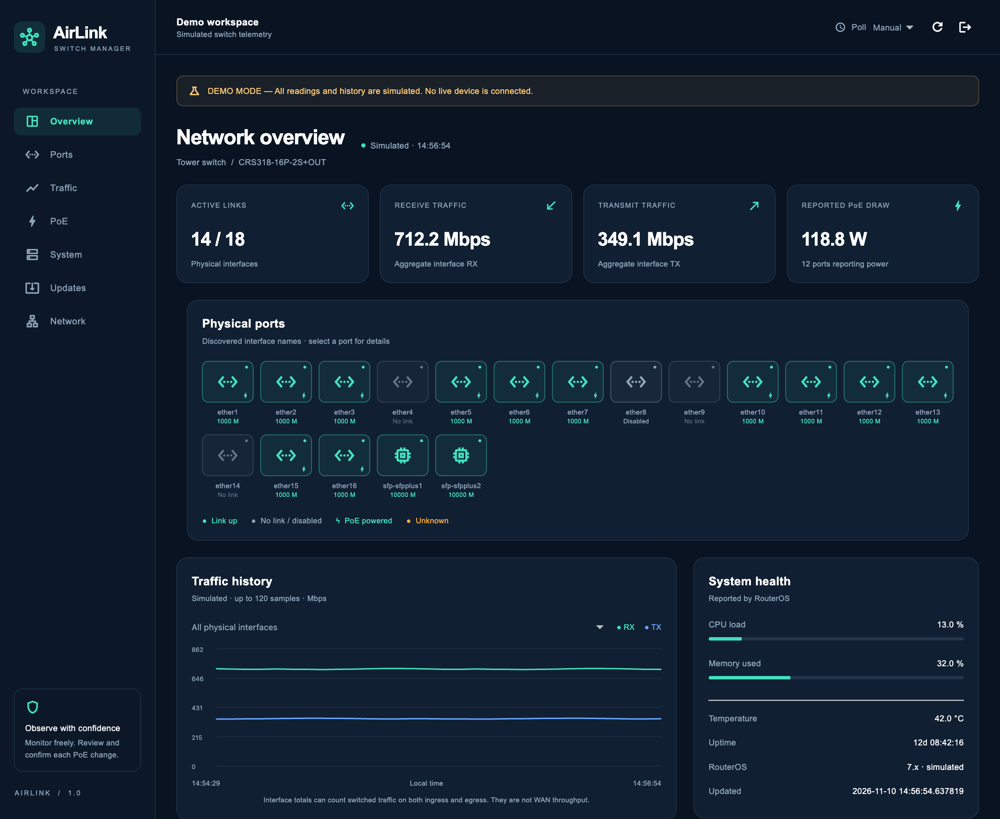

# AirLink MikroTik Switch Manager

A Flutter dashboard with authenticated RouterOS SSH monitoring and separately
permissioned, explicitly confirmed PoE on/off controls.
The selected workspace was empty at inspection; this project was created here rather
than modifying an existing collector. No live switch access was provided.

Supported inventory: **netPower 16P / CRS318-16P-2S+OUT** (16 Ethernet + 2 SFP+) and
**CRS112-8P-4S-IN** (8 Ethernet + 4 SFP). The backend verifies reported model,
architecture and discovered physical interfaces. Renamed interfaces retain their
reported name and factory `default-name`. An unsupported inventory fails closed.

## What is implemented

- Responsive navy/teal Overview, Ports, Traffic, PoE, System, Updates and Network screens.
- Network drafts with DHCP/static IPv4 selection, interface, subnet prefix, optional
  gateway/DNS, validation and local per-profile persistence. Applying settings to a
  device is not implemented. See [network configuration](docs/NETWORK.md).
- Future AirLink firmware update readiness and local manifest metadata review.
  Installation remains disabled; see [the update guide](firmware/UPDATE-PROTOCOL.md).
- **Updates → Check board & online catalog** reads fresh backend board identity and
  checks the public HTTPS firmware catalog. A standalone Linux prototype reports
  available board/system data at startup and periodically checks for exact-target
  release metadata. See [board probe and online checks](docs/BOARD-AGENT.md).
- Generic Linux startup integration with a staged systemd service and isolated Linux
  runtime tests. This is [development integration](firmware/integration/linux/README.md),
  **not verified switch firmware or a flash image**.
- Connection screen, backend device discovery, saved profile metadata, explicit demo
  mode for both models; the backend access token is only held in session memory.
- Link state, enabled state, negotiated speed/duplex, byte counters, RX/TX Mbps,
  timestamped in-session history, PoE readings and available system/temperature metrics.
- Manual refresh and 5/10/30/60-second polling, no overlapping requests, cancellation,
  loading/error/unsupported states, unavailable values, stale warnings and update times.
- RouterOS SSH framing/parsing, strict host-key validation, timeouts, bounded output,
  partial-command handling, counter resets/reboots, per-device lock/cache/backoff.
- Separate firmware research workspaces. **No bootable or installable firmware.**
- Per-port **On (Auto)** / **Off** actions in the PoE section, a separate operator token,
  fresh device/configuration checks and a single-use confirmation. No forced-on action.

This is a development implementation, **not production-certified or live-device verified**.
See [validation and remaining work](docs/VALIDATION.md) and [firmware investigation](firmware/README.md).

## VS Code setup

1. Install Flutter stable with Dart, VS Code, and the recommended Dart/Flutter extensions.
   This project was generated/tested with **Flutter 3.47.6 / Dart 3.13.5** on macOS.
   Open this folder with `code .` (or File → Open Folder). The Flutter app is at the root.
2. Run `flutter doctor -v`. Configure the relevant host toolchain: Xcode for macOS/iOS,
   Android SDK/JDK for Android, Visual Studio C++ desktop tools for Windows, or Linux
   desktop development packages. Platform folders for all five requested systems exist.
3. Run `flutter pub get`. In VS Code, select a device in the status bar, select
   **AirLink · Flutter** in Run and Debug, then press **F5**.
4. On the connection screen, choose **Demo · netPower 16P** or **Demo · CRS112** to explore
   without a backend. Every simulated screen has a persistent DEMO MODE banner.

CLI alternatives:

```sh
flutter run -d macos
# On the appropriate host, with a configured device/toolchain:
flutter run -d windows
flutter run -d linux
flutter devices
flutter run -d DEVICE_ID
# Optional browser target:
flutter run -d chrome --web-port=8080
```

Windows/Linux builds require their respective hosts. iPhone builds require your own
signing team in Xcode; no personal signing identity is embedded in project configuration.
Android Internet permission and macOS outgoing-network entitlements are included.
Mobile connections should use a trusted HTTPS backend hostname; localhost means the
phone itself. TLS certificate verification is never bypassed.

## Backend setup (macOS/Linux)

Python 3.9+ is compatible with the tested dependency set; use a currently maintained
Python release for deployment. From the project root:

```sh
python3 -m venv backend/.venv
backend/.venv/bin/python -m pip install -r backend/requirements.txt
cp backend/devices.example.json backend/devices.json
```

On Windows, use `py -m venv backend/.venv` and `backend\.venv\Scripts\python.exe`.
Run commands below with the corresponding Windows virtual-environment executable.

Edit `backend/devices.json`. Each device has a unique ID, label, SSH host/port, dedicated
monitoring username, exact expected product code, and an **absolute** known-hosts path.
For SSH authentication use either a backend-only private-key path or an environment
variable name containing its password. The example uses documentation-only IP addresses;
replace them. No router secret is accepted by or delivered to Flutter.

Create the RouterOS monitoring account yourself with the minimum supported read/SSH
permissions. Restrict it and the SSH service to the backend's management address. Test
whether the installed version requires additional read/monitor permissions before
adding them; do not grant `write`, `policy`, `reboot` or `sensitive` just to make a query
succeed. The monitoring account remains read-only. Optional PoE control uses a separate
account described below; the application never creates router users.

### Optional PoE on/off control

PoE control is disabled by default. No live power changes were tested or performed.

1. An administrator must configure a separate RouterOS SSH account for control, with
   the required `read`, `write` and `ssh` policies, restricted to the backend address.
   RouterOS `write` permission is broader than PoE: the backend allowlist constrains
   this application's actions, not everything that account could do outside it.
   Keep the original monitoring account read-only. See MikroTik's
   [user policy reference](https://manual.mikrotik.com/docs/authentication-authorization-accounting/user/).
2. In the chosen backend device profile, set `control_username` and either
   `control_key_file` or `control_password_env`. These credentials stay on the backend;
   the same verified `known_hosts` file is used. The example configuration contains
   placeholders, no real credentials.
3. Set `poe_control_ports` to the **factory names** of ports deliberately approved for
   switching, for example `["ether2"]`. Exclude ports powering your management path.
   The application cannot determine which connected device provides remote access.
   An empty list keeps all live controls disabled. SFP ports cannot be added.
4. Supply a distinct random `AIRLINK_CONTROL_TOKEN` of at least 32 characters through
   the backend's environment/secret store, using the same private-input procedure as
   the monitoring token below. Restart the backend with **one worker**. Tokens must
   differ; controls without a separate SSH username/token fail configuration validation.
5. Connect normally with the monitoring token. In **PoE**, refresh, select a port's
   **On (Auto)** or **Off**, enter the operator token, and choose **Review current setting**.
   Check the port and current-to-requested mode, acknowledge potential power loss and
   management disconnection, then confirm within 60 seconds. Cancel sends no write.

On selects RouterOS `auto-on`, which performs detection; it does not promise the
connected load will receive power. Off selects `off`. Existing `forced-on` settings
are displayed but never enabled or restored automatically. Changing a forced-on port
to Auto can interrupt power. No voltage selection, interface enable/disable, automatic
power-cycle, scheduled toggle or Linux firmware is involved. These mode semantics are
documented in [MikroTik PoE-Out](https://help.mikrotik.com/docs/spaces/ROS/pages/19136769/PoE-Out).

The backend verifies identity, physical inventory, current name and PoE configuration
before preparation and again before writing, then reads back the configured mode.
It shares the device lock with monitoring. Confirmation is single-use, bound to the
device/port/mode, expires after 60 seconds, and is lost on backend restart. A new
preparation replaces that device's previous pending confirmation.

A lost response may mean power already changed. The app marks telemetry stale, reports
an unknown outcome, and never repeats or reverses the write automatically. Close and
refresh; verify actual configuration before starting another action. Verified mode is
not proof of electrical power delivery. RouterOS v6/v7 behavior on physical switches
still requires a controlled acceptance test on a non-management port.

Demo controls simulate changes locally and remain explicitly labeled. The operator
token is held only for the dialog/action and is never saved in device profiles.

### Verify SSH host keys

Obtain each SSH server public host key/fingerprint through a trusted independent channel
(e.g. a known-good administrator connection). `ssh-keyscan` only retrieves an **untrusted**
candidate; it does not verify identity. Compare its fingerprint with that trusted record
before placing the key in a private backend `known_hosts` file. Nonstandard ports use
`[host]:port` entries. Use the same hostname/IP as the configured connection.

Unknown or changed keys are rejected. There is no auto-accept policy or interactive
trust-on-first-use shortcut. Investigate changes before replacing a pinned key.

### Configure secrets without committing them

The backend reads the process environment; `.env.example` is documentation and is **not**
automatically loaded. Prefer a service secret store. For an interactive Bash/Zsh session,
this helper prompts without echo and exports values only in the current shell:

```sh
# Generate your own random backend token locally, keep it in your password manager:
backend/.venv/bin/python -c 'import secrets; print(secrets.token_urlsafe(32))'
# Enter that token and the router password privately (use only needed password variables):
export AIRLINK_API_TOKEN="$(backend/.venv/bin/python -c 'import getpass; print(getpass.getpass("Backend token: "))')"
export AIRLINK_TOWER_PASSWORD="$(backend/.venv/bin/python -c 'import getpass; print(getpass.getpass("Router password: "))')"
export AIRLINK_CONFIG="$PWD/backend/devices.json"
```

The API token must be at least 32 characters; use a cryptographically random token.
Do not paste secrets into source, VS Code launch configuration, URLs or `--dart-define`.
Local config, environment files, private keys and known-host files are gitignored.
Restrict backend configuration/key file permissions to the service account.

### Local development

```sh
export AIRLINK_ALLOW_LOOPBACK_HTTP=1
# Set only when using the optional Flutter browser target:
export AIRLINK_CORS_ORIGINS=http://localhost:8080
cd backend
.venv/bin/uvicorn airlink.app:create_app --factory --host 127.0.0.1 --port 8000 \
  --workers 1 --no-proxy-headers --no-access-log
```

Use `http://127.0.0.1:8000` in the native desktop app. Cleartext is allowed only for
explicit loopback development. Authentication is still required. Native mobile builds
use HTTPS; no broad insecure-transport exemption has been added.

### Remote HTTPS

Use a certificate valid for the hostname and trusted by the client. Either terminate
TLS directly in uvicorn:

```sh
cd backend
unset AIRLINK_ALLOW_LOOPBACK_HTTP
.venv/bin/uvicorn airlink.app:create_app --factory --host 0.0.0.0 --port 8443 \
  --ssl-certfile /absolute/path/fullchain.pem --ssl-keyfile /absolute/path/privkey.pem \
  --workers 1 --no-proxy-headers --no-access-log
```

Or adapt [backend/Caddyfile.example](backend/Caddyfile.example), keep uvicorn bound to
loopback, and allow forwarded headers **only from the local proxy**:

```sh
cd backend
unset AIRLINK_ALLOW_LOOPBACK_HTTP
.venv/bin/uvicorn airlink.app:create_app --factory --host 127.0.0.1 --port 8000 \
  --workers 1 --proxy-headers --forwarded-allow-ips=127.0.0.1 --no-access-log
```

Do not expose the plaintext proxy upstream port. Do not trust arbitrary forwarded headers.
Use one worker: per-device locks, rate baselines and caches are process-local. A multi-process
or HA deployment needs shared coordination, which is not implemented. Allow only exact
trusted web origins if browser access is required; native clients do not need CORS.

### Connect Flutter

1. Enter the backend HTTPS origin (or desktop loopback development URL).
2. Enter the backend API token, then **Find configured devices**.
3. Select the backend profile and **Connect & save profile**. The saved profile contains
   label, URL and device ID only. Re-enter the token in each new session.
4. The first valid counters establish a baseline; rates need another successful sample.
   Set a polling interval or refresh manually. Changing polling intervals preserves history.
5. Disconnect returns to profiles and clears session credentials and telemetry.

The collector supports documented RouterOS `as-value` scripting over SSH, without
assuming REST or recent JSON-serialization commands. It must be exercised against your
installed RouterOS versions. SwOS-only sessions are not supported by this collector.
Optional commands/sensors can be unavailable because of version, permissions or hardware.
A complete result is not claimed when sections fail.

## API and semantics

Both endpoints require `Authorization: Bearer <token>`:

- `GET /api/v1/devices`: safe device-profile metadata, no router credentials/addresses.
- `GET /api/v1/devices/{id}/snapshot`: versioned, timestamped telemetry JSON.

See [docs/API.md](docs/API.md). Errors: 401 authentication, 404 unknown profile,
422 unsupported/mismatched hardware, 503 unavailable/in-progress collection. Cached
readings on failures have `stale: true` and retain `last_success_at`. Logs do not contain
raw SSH responses or credentials. No control/configuration endpoints exist.

History is bounded to 120 samples **in the current app session**, not persisted or
collected while the client is closed. Counter intervals use monotonic backend time.
Missing data is `null`, never a zero substitute. Aggregate rates require every port's
rate; reported PoE draw is a labeled sum of reporting ports. Interface RX/TX totals may
count switched traffic twice and must not be interpreted as internet/WAN throughput.

## Validation and screenshots

```sh
dart format lib test integration_test test_driver
flutter analyze
flutter test
PYTHONPATH=backend backend/.venv/bin/python -m pytest backend/tests -q
flutter build macos --debug
flutter drive -d macos --driver=test_driver/integration_test.dart --target=integration_test/app_test.dart
```

The integration walkthrough runs the actual native app and exports its rendered screens
through Flutter driver. macOS screen capture was unavailable, so these captures exclude
OS chrome. They are not generated mockups. See [capture metadata](docs/screenshots/capture.json).



[Connection screen](docs/screenshots/connection-macos.png) ·
[CRS112 demo](docs/screenshots/demo-crs112-overview-macos.png) ·
[System demo](docs/screenshots/demo-system-macos.png) ·
[Traffic demo](docs/screenshots/demo-traffic-macos.png) ·
[PoE controls demo](docs/screenshots/demo-poe-controls-macos.png) ·
[PoE confirmation demo](docs/screenshots/demo-poe-confirmation-macos.png) ·
[Phone-width layout on macOS](docs/screenshots/demo-mobile-layout-macos.png)

## Remaining hardware work

### Package the available host application

On macOS, after the validation commands above:

```sh
flutter build macos --release
flutter build web
python3 scripts/package_release.py
```

The packaging script creates a new timestamped directory under `dist/` containing
`airlink-macos.zip`, `airlink-web-backend.zip`, `airlink-source.zip`, `manifest.json`
and `SHA256SUMS`. `dist/LATEST.txt` names the newest package directory.
The macOS archive contains the optimized application; the web/backend archive includes
compiled web assets, backend Python source, dependency pins, example configuration and
setup instructions. Real configuration, credentials, host keys and virtual environments
are excluded through an explicit file selection. Configure the backend privately before
using live monitoring or PoE control.

The source archive includes Flutter/platform sources, backend, tests and research
documentation. See [release notes](docs/RELEASE-NOTES.md) for the public release scope.

The macOS build is currently universal (Intel/Apple Silicon), ad-hoc signed and **not
Developer-ID signed or notarized**. The script stages without Finder/resource-fork
metadata and checks the app signature before and after an archive extraction. It verifies
ZIP integrity and records hashes. These are local development artifacts, not published
downloads or production certification. Neither archive is MikroTik firmware.

No physical switches, SSH credentials or trusted host keys were supplied, so neither
live model was verified. Supply those through private backend configuration, then use
the acceptance checklist in [docs/VALIDATION.md](docs/VALIDATION.md).

Linux firmware is intentionally unfinished pending exact-board evidence. The required
board revision/RouterBOOT logs, flash map, SoC/ASIC/PoE documentation, console and recovery
access are listed in [firmware/README.md](firmware/README.md). Board support, switch/PoE
drivers, flash layout, root filesystem packaging and recovery are not complete. Nothing
in this project flashes hardware or overwrites RouterOS.
